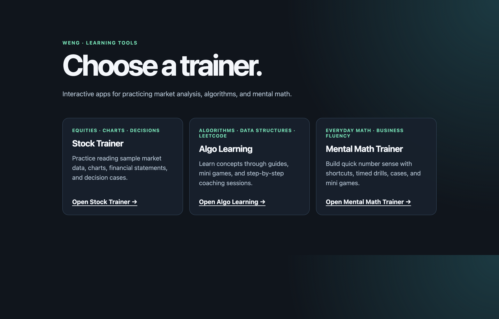

# new-trainer-app — create a trainer app to master anything

By Weng (Weng Fei Fung)


<a target="_blank" href="https://github.com/Siphon880gh" rel="nofollow"></a>
<a target="_blank" href="https://www.linkedin.com/in/weng-fung/" rel="nofollow"></a>
<a target="_blank" href="https://www.youtube.com/@WengTeachesCode/" rel="nofollow"></a>

**TL;DR:** This AI skill asks what you want to learn or master that requires deep, daily training, then creates the interactive web app you need to master it — e.g. electrical circuits so you can build automations, or learning piano.

## What it does

You give it a **learning goal or mastery goal**, phrased the way you would say it to a tutor: "master electric circuits so I can build small robots and home automation", "get fluent at mental math for investor conversations", "learn to read stock charts and decide before the aftermath". The skill then creates an **interactive web app that teaches, coaches, and quizzes you** on that topic, in whatever folder you choose. If you host several trainers behind a launcher page like the one below, it can add a card there too; that part is optional.

Based on your goal, it decides **what kinds of learning and quizzing** the app should have. Not every topic needs the same things: circuits need fault-diagnosis cases and a small simulation; mental math needs timed drills; stock reading needs decide-and-reveal cases; piano needs step-by-step coaching and spaced recall. The skill picks from concept guides, step-by-step coaching trees, timed drills, quizzes, decision cases, hands-on labs, simulations, mini games, and cheatsheets, and justifies each choice in the plan.

It also **scrapes online for knowledge context** before it builds: open-source textbooks and course repos, book tables of contents, course syllabi, official docs. Those go into a `context/` folder the app's authoring loops read from (rewritten in original words, never pasted). If a source is paywalled or unreachable, it tells you and asks instead of guessing.

The apps below were built this way and are what the skill templates come from:



Live: [wengindustries.com/trainer](https://wengindustries.com/trainer/) — Stock Trainer, Algo Learning, Mental Math Trainer.

## How it works

Three phases, each in its own Cursor session:

1. **Plan** (interactive): syllabus catalog with a join key, tracks, Beginner path, resource types chosen from a pedagogy map, computable coverage floors, reference material under `context/`
2. **Runtime** (autonomous `/loop`): `AGENTS_LOOP-Continue-Milestone.md` builds the app one story per tick until MVP freeze
3. **Content** (autonomous `/loop`): `LOOPS/LOOP-Graph.md` picks a section loop each tick and fills guides, coach trees, drills, cases, labs, simulations, games until every floor is met

The skill writes planning docs and loop prompts. It does not write runtime code; the loops do. "Mastered" is defined as a number (every unit in the syllabus meets its coverage floor on every declared mastery rung), so the content loop knows when to stop.

## Install

Clone into the skills folder of any workspace (project-level) or your home folder (available everywhere):

```bash
# project
git clone https://github.com/Siphon880gh/skill-create-trainer-app-to-master-anything.git .agents/skills/new-trainer-app

# or personal
git clone https://github.com/Siphon880gh/skill-create-trainer-app-to-master-anything.git ~/.agents/skills/new-trainer-app
```

The skill is `disable-model-invocation: true`, so invoke it by name. The new app can be created in **any folder**; it does not need to sit next to other trainers, and it never depends on them at runtime.

## Use

In Cursor:

```text
Use the new-trainer-app skill to create a trainer for electrical circuits, for a maker who wants to build devices and smart-home automations. Put it in ~/dev/apps.
```

The agent will:

- run `scripts/scaffold.sh` to create `<app-slug>/` (own git repo) with every artifact pre-filled with tokens
- act as a subject expert and research sources (open repos, book TOCs, course syllabi) into `<app>/context/`
- choose resource types with a justification table
- fill `EPIC_MAP.md`, `IMPLEMENTATION_STORIES.md`, `RESOURCES.md`, `.agents/state.json`, `.impeccable.md`, the milestone loop, the content graph, and one section loop per type
- add a card to your launcher page if you have one (optional)
- hand you the Phase 2 command

Then, in a **new** session inside the app folder:

```text
/loop continue milestones using AGENTS_LOOP-Continue-Milestone.md
```

After MVP freeze, in another new session:

```text
/loop content graph using LOOPS/LOOP-Graph.md
```

## Manual scaffold

```bash
bash ~/.agents/skills/new-trainer-app/scripts/scaffold.sh circuits-trainer "Circuits Trainer" CIRCUIT_CORE \
  "electrical circuits for devices and smart homes" --stack php --dest ~/dev/apps
```

Options: `--stack php|vite` (default `php`), `--join-key <name>` (default `familyId`), `--dest <dir>` (default cwd; created if missing). The script refuses to overwrite an existing folder, substitutes `{{TOKENS}}`, writes `.gitignore`, makes the first commit, and reports whether a launcher `index.php` with an `$apps` array exists in `--dest` (if not, the card step is skipped). Every `<!-- agent: -->` / `AGENT:` marker left in the output must be filled by the agent in Phase 1.

## Layout

```
new-trainer-app/
├── SKILL.md                     # the workflow (Phase 1 checklist, constraints, handoff)
├── README.md                    # this file
├── reference/
│   ├── conventions.md           # artifact inventory + hard constraints from the three apps
│   ├── pedagogy-map.md          # domain kind → resource types; mastery ladder; floors
│   └── research.md              # context/ sourcing rules, licensing, when to ask the human
├── templates/
│   ├── EPIC_MAP.md
│   ├── IMPLEMENTATION_STORIES.md
│   ├── RESOURCES.md
│   ├── state.json               # → <app>/.agents/state.json
│   ├── AGENTS_LOOP-Continue-Milestone.md
│   ├── LOOPS/{README,LOOP-Graph,LOOP-Section}.md
│   ├── context/{clone.sh,README.md}
│   ├── agents-skills/add-unit/SKILL.md   # seed for <app>/.agents/skills/add-*
│   ├── impeccable.md            # → <app>/.impeccable.md
│   ├── README.md                # → <app>/README.md
│   ├── gitignore                # → <app>/.gitignore
│   └── index-php-card.php       # snippet for trainer/index.php
├── scripts/
│   └── scaffold.sh
└── docs/
    └── trainer-apps-launcher.png
```

## Design decisions

- **Phases are separate sessions.** Research may ask questions; loops never do except via stop conditions. Running the milestone loop and the content graph in one session is forbidden, matching the existing apps.
- **"Mastered" is a number.** Done(graph) is computed from the family catalog × per-type floors × declared mastery rungs. No loop runs "until it feels complete".
- **`context/repos/` is gitignored; `context/toc/` and `context/notes/` are tracked.** Clones are reproducible via `clone.sh`; the agent's own outlines and notes are small and worth keeping.
- **Guides and Coach are mandatory.** Every other type is chosen per topic from `reference/pedagogy-map.md` with a one-line justification. Simulations are allowed but scoped as their own epic with a tiny deterministic model.
- **Shared constraints are inherited verbatim:** deterministic coaching trees, no runtime LLM, SAMPLE data, `localStorage` progress, rewrite never paste, one join key, one unit per tick, 10-round error budget.

## Updating the skill

When an app built with this skill settles on a better pattern (a cleaner state shape, a better section loop), fold it back into `templates/` and commit here, so the next app starts from it.
